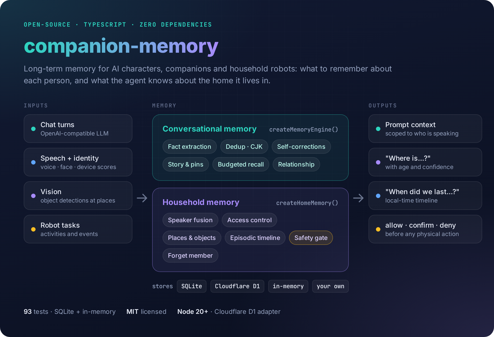
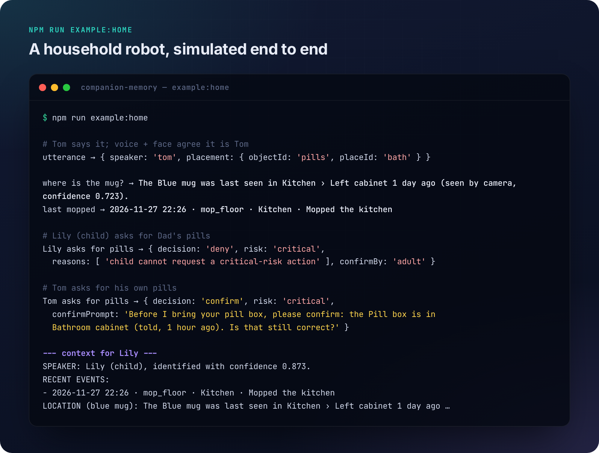
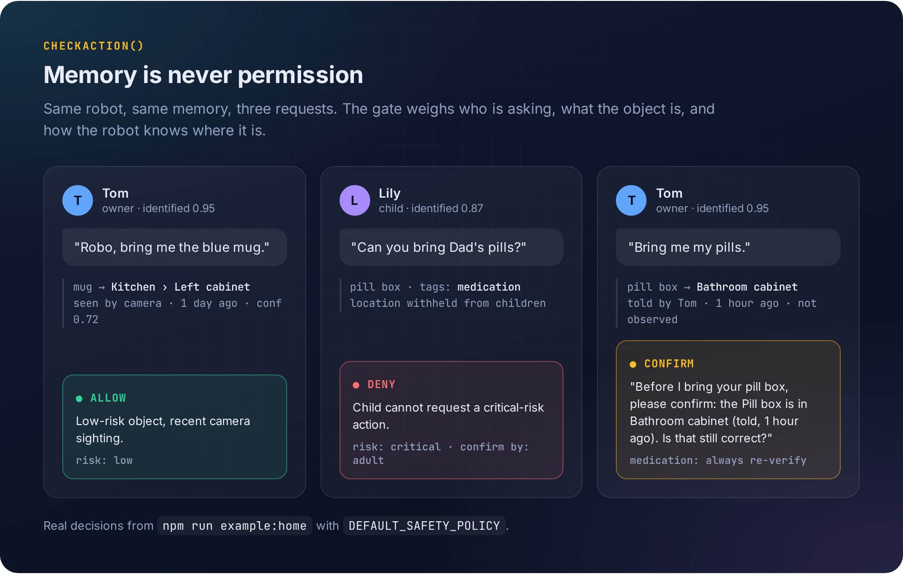

# companion-memory

<p align="center">
  
</p>

Long-term memory for AI characters, companions, assistants and **household robots**, in TypeScript with no runtime dependencies.

It answers two questions: **what should the agent remember about each person, and what does it know about the home it lives in?**

- **Conversational memory** (`createMemoryEngine`): facts, story, pins and relationship state per user and agent.
- **Household / embodied memory** (`createHomeMemory`): who is speaking, where things are, what happened when, and whether a physical action that relies on memory is safe to take. See [Household and robot memory](#household-and-robot-memory).

- **Fact extraction**: an LLM pulls durable facts from recent turns (user / character / side characters), backed by deterministic rules for the most common facts. It still works when the LLM is down.
- **Noise filtering and dedup**: drops "lol" and "I'm tired today"; merges paraphrases (stemmed token overlap, CJK bigrams).
- **Self-corrections**: "I no longer drink coffee" disables the stale auto-extracted fact. Manual facts are never touched.
- **Budgeted recall**: renders story + pins + facts into a prompt block within a character budget, degrading gracefully (user facts survive longest), plus rules that stop the model from inventing memories.
- **Relationship state**: familiarity stages, trust / attachment / romance, idempotent turn counting (client retries do not double count).
- **Safe extraction gating**: per-turn idempotency, rate limiting and a compare-and-set lock, so concurrent requests do not extract twice.
- **Shared persona**: facts saved under a shared agent id (e.g. "user is vegetarian") are known by every agent of that user.
- **Pluggable storage and model**: in-memory, SQLite (`node:sqlite`, `better-sqlite3`), Cloudflare D1, or your own `MemoryStore`; any OpenAI-compatible endpoint (OpenAI, vLLM, Ollama, LM Studio, OpenRouter, LiteLLM).

Extracted from an AI-character chat app I built, then cleaned up into a standalone library.

## Install

```bash
npm install companion-memory
```

Requires Node 20+ (uses Web Crypto). `SqlStore` with `node:sqlite` needs Node 22.5+.

## Quick start

```ts
import {DatabaseSync} from 'node:sqlite';
import {createMemoryEngine, SqlStore, fromNodeSqlite, openAICompatibleClient} from 'companion-memory';

const store = new SqlStore(fromNodeSqlite(new DatabaseSync('memory.db')));
await store.migrate();

const memory = createMemoryEngine({
  store,
  llm: openAICompatibleClient({baseURL: 'http://localhost:11434/v1', model: 'qwen2.5:7b'}),
});

const key = {userId: 'user-42', agentId: 'aria'};

// 1) Before calling your chat model: put memory into the system prompt.
const memoryBlock = await memory.buildPrompt(key, {includeRelationship: true});
const system = `${characterCard}\n\n${memoryBlock}`;

// 2) After the reply: count the turn and extract facts (fire-and-forget is fine).
await memory.recordUserTurn(key, turns);
await memory.extract({key, characterName: 'Aria', userName: 'Sam', turns, userTurn});
```

Try it offline (a scripted fake model is used when `LLM_BASE_URL` is unset):

```bash
npm install && npm run example
LLM_BASE_URL=http://localhost:11434/v1 LLM_MODEL=qwen2.5:7b npm run example
```

## Concepts

| Concept | Meaning |
|---|---|
| `MemoryKey` | `{userId, agentId}`. `agentId` is whatever the user talks to: a character, an assistant, a robot. |
| Fact | One short sentence with `scope` = `persona` (about the user) / `character` / `side` (named side character), `source` = `auto` or `manual`. |
| Pin | A message kept verbatim. |
| Story | Free-form user-written memory ("the story so far"). |
| Relationship | Familiarity stage plus trust / attachment / romance (0–100). |

## Engine API

| Method | Purpose |
|---|---|
| `buildPrompt(key, {includeRelationship?})` | Memory block for the system prompt, within `limits.budgetChars`. |
| `extract({key, characterName, userName?, turns, userTurn, threadId?})` | Extract + store facts; returns `added`, `disabledIds`, or why it skipped. |
| `snapshot(key)` | Story, pins, facts (with shared persona) and budget usage, e.g. for a "memory" UI panel. |
| `recordUserTurn(key, turns)` / `raiseBond(key, bond, note?)` / `relationship(key)` | Relationship state. |
| `setStory`, `pin`, `unpin`, `addFact`, `updateFact`, `removeFact`, `clear` | User-editable memory. |

Limits (all optional) are in `DEFAULT_LIMITS`: `maxFacts`, `maxPins`, `maxStoryChars`, `budgetChars`, `recallFactLimit`, `maxNewFactsPerExtract`, `minExtractIntervalSec`, `durablePersonaOnly`, `allowedScopes`. Two engines with different limits make an easy free / paid split.

Every building block (`parseFactExtractionOutput`, `isNearDuplicateFactContent`, `findSupersededFacts`, `buildMemoryPromptBlock`, `applyUserTurn`, ...) is exported as a pure function if you only want parts.

## Storage

```ts
import {InMemoryStore, SqlStore, fromNodeSqlite, fromD1, SCHEMA_SQL} from 'companion-memory';

new InMemoryStore();                              // tests, demos
new SqlStore(fromNodeSqlite(new DatabaseSync('m.db'))); // node:sqlite or better-sqlite3
new SqlStore(fromD1(env.DB));                     // Cloudflare D1 (run SCHEMA_SQL as a migration)
```

Implement `MemoryStore` for anything else (Postgres, Redis, ...). `beginExtraction` must be atomic; `decideExtraction` gives you the shared policy.

## Household and robot memory

`createHomeMemory` adds the memory a home robot needs on top of the conversational engine. Everything is scoped by `homeId`; each member's personal memory stays in the core engine under `{userId: memberId, agentId: robotId}`.

```ts
import {createHomeMemory, createMemoryEngine, SqlHomeStore, SqlStore, fromNodeSqlite} from 'companion-memory';

const driver = fromNodeSqlite(new DatabaseSync('home.db'));
const homeStore = new SqlHomeStore(driver);
const coreStore = new SqlStore(driver);
await homeStore.migrate();
await coreStore.migrate();

const home = createHomeMemory({
  homeId: 'home-1',
  robotId: 'robo-1',
  robotName: 'Robo',
  store: homeStore,
  memory: createMemoryEngine({store: coreStore, llm}),
  utcOffsetMinutes: 480, // the home's time zone, for "today" / "yesterday"
});
```

Try it: `npm run example:home`.

<p align="center">
  
</p>

### What it covers

| Capability | API | Notes |
|---|---|---|
| **Speaker identification (fusion)** | `identify(signals)` | Fuses scores from *your* voice / face / device / self-introduction models (weighted noisy-OR) into `identified` / `ambiguous` / `unknown`. A shared name ("Tom") is never trusted on its own. This library does not do biometrics. |
| **Access control** | `memoryAccessFor(speaker)` | Unknown speakers get household read-only access and nothing personal. Personal memory is read and written only for the identified member. |
| **Spatial and object memory** | `upsertPlace`, `upsertObject`, `ingest({type: 'object_seen'})`, `whereIs(query, {speaker})` | Place hierarchy from your map (`mapRef` links to your map frame). Current location decays with age (half-life); told and inferred reports weigh less than observations; habitual location ("usually in the cupboard"); "my keys" prefers the speaker's own object. |
| **Sensitive locations** | `whereIs(query, {speaker})` | Locations of medication, hazardous, child-restricted and valuable items are withheld from children, guests and unidentified people. |
| **Episodic memory** | `recordEpisode`, `episodes({range, labels, actorId, placeId, objectId, text})`, `lastTime(label)` | Timeline of tasks, activities, events and presence; local-time ranges (`today`, `yesterday`, `this_week`, ...); presence sightings merge into visits. |
| **Safety gate** | `checkAction({action, requester, objectTags, evidence})` | Memory is never permission. Returns `allow` / `confirm` / `deny`, reasons, a confirmation question and who may confirm. Medication / allergens / hazardous items are always re-verified; children and guests cannot request high-risk actions; hearsay is not enough for high-risk actions; stale or low-confidence evidence needs confirmation. |
| **Multimodal input** | `ingest(observation)` | `object_seen` (vision), `placement_told` (your NLU), `utterance` (ASR text + identity signals; parses simple English placements and runs fact extraction for the identified speaker), `person_seen`, `activity` (task system). |
| **Prompt context** | `buildContext({speaker, objectQueries})` | Speaker identity, that member's memory, household facts, recent events, requested locations, and rules for the robot's LLM. |
| **Privacy and retention** | `forgetMember(id)`, `prune(...)`, `clearHome()` | Right to be forgotten across home and conversational memory; age-based pruning that keeps important episodes. |

All policies (`DEFAULT_SPEAKER_POLICY`, `DEFAULT_SPATIAL_POLICY`, `DEFAULT_SAFETY_POLICY`) are plain objects you can override.

<p align="center">
  
</p>

### Responsibilities that stay with your robot stack

This library is the memory and policy layer. For a commercial deployment you still own:

- **Perception and biometrics**: voice / face recognition, object detection, localization. Feed their outputs into `ingest` and `identify`.
- **Calibration**: the default thresholds are sensible starting points, not tuned on your sensors. Measure false-accept rates for speaker identification and tune `DEFAULT_SPEAKER_POLICY` before relying on it.
- **Final action safety**: `checkAction` is one gate before motion planning, not a replacement for your robot's functional-safety system.
- **Data protection**: encrypt the database at rest, and get consent for storing household members' data under your jurisdiction's rules.

## Limitations (honest list)

- Recall is **recency-based**, not semantic. With hundreds of facts per user, you will want embeddings or a reranker; the `factLimit` / budget hooks are where to plug that in.
- The deterministic rules and correction patterns are **English**. Other languages rely on the LLM (dedup does handle CJK).
- Corrections are pattern-based ("no longer", "quit", "stopped", "... anymore"); subtle contradictions are left to the LLM's "skip unless changed" instruction.
- Extraction quality depends on your model. Tiny models produce more junk (filtered, but not perfectly).
- `parsePlacementStatement` understands simple English only ("I put my keys on the hall table"). For other languages, parse in your NLU and send `placement_told`.
- Object and place name matching is lexical (names, aliases, light singularization), not semantic.

## Roadmap

- **Done (0.1):** conversational memory for characters, companions and assistants.
- **Done (0.2):** household / embodied memory: speaker fusion and access control, spatial and object memory, episodic timeline, safety gate, multimodal ingest.
- **Next:** pluggable semantic retrieval (embeddings / reranker) for facts, objects and episodes; multilingual placement parsing; a ROS 2 bridge example.

Feedback on these directions is welcome in issues.

## Development

```bash
npm test          # vitest (runs every engine test against InMemoryStore and SqlStore)
npm run typecheck
npm run build
```

## License

MIT
